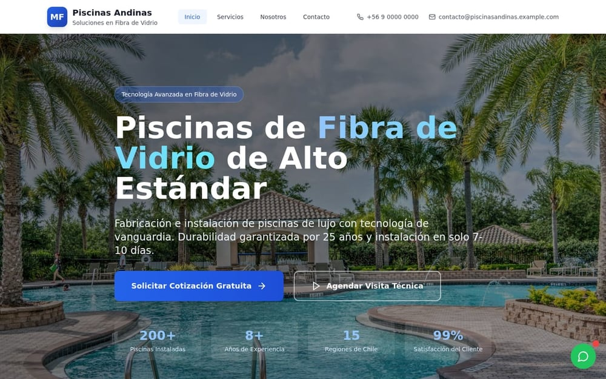
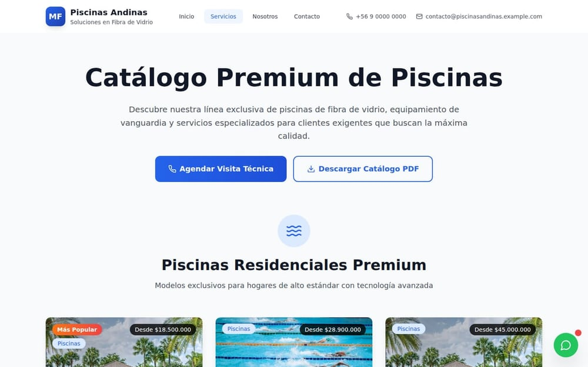
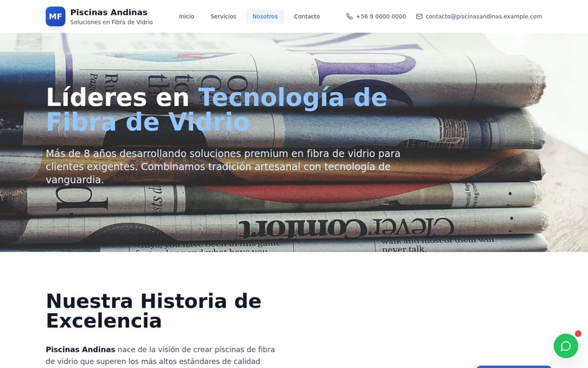
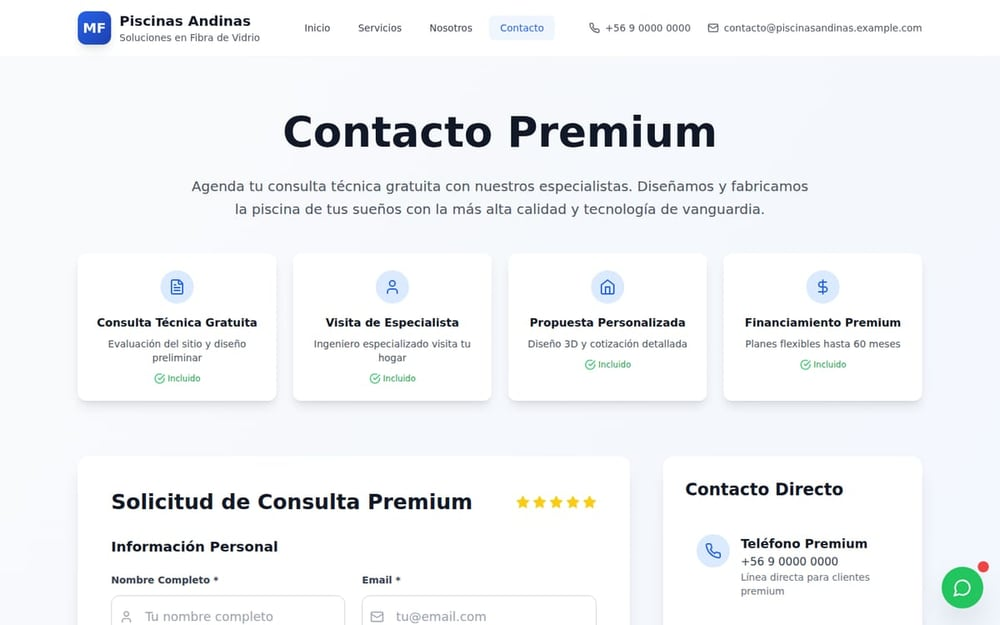
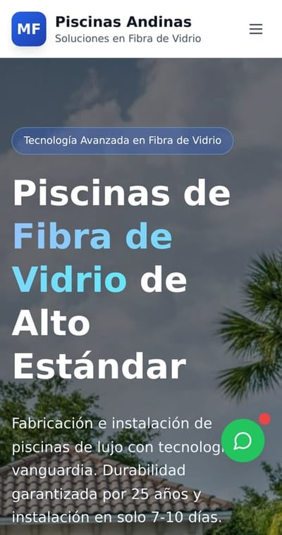
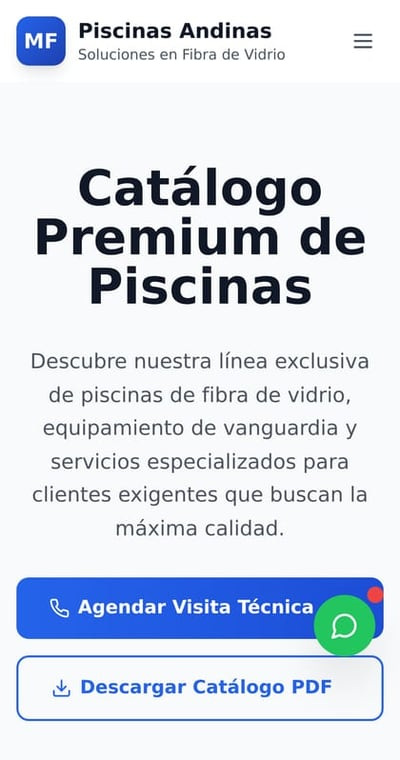
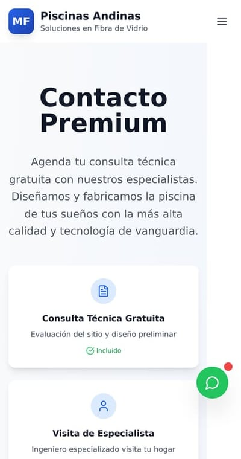

# Piscinas Andinas

> **Escaparate público.** Versión de portafolio de este producto para demostrar diseño,
> arquitectura y flujos. No incluye infraestructura, configuración ni credenciales.

**High-conversion fiberglass pool company site**

**Version:** 1.0.0 · **Year:** 2026 · **Status:** LIVE

## Overview

A production-oriented marketing and lead-generation web app for a fiberglass pool company: A/B testing, analytics instrumentation, conversion tracking, live chat, SEO metadata, accessibility helpers, and runtime monitoring.

## Vitrina — capturas y documentación técnica

**[`vitrina/`](vitrina/README.md)** reúne la presentación pública del proyecto: 7 capturas del
sitio compilado (desktop y móvil), arquitectura, funcionalidades y ficha técnica.

| Documento | Contenido |
|---|---|
| [`vitrina/README.md`](vitrina/README.md) | Presentación, capturas, qué resuelve, alcance |
| [`vitrina/docs/ARQUITECTURA.md`](vitrina/docs/ARQUITECTURA.md) | Orden de proveedores y decisiones |
| [`vitrina/docs/FUNCIONALIDADES.md`](vitrina/docs/FUNCIONALIDADES.md) | Módulos y para quién existe cada uno |
| [`vitrina/docs/FICHA-TECNICA.md`](vitrina/docs/FICHA-TECNICA.md) | Stack, métricas y defectos corregidos |

Las capturas se generan automáticamente con Playwright desde el build; no son montajes manuales.

### Galería

**Escritorio**

|  <b>Portada</b> |  <b>Servicios</b> |  <b>Nosotros</b> |
|---|---|---|
|  <b>Contacto</b> | &nbsp; | &nbsp; |

**Móvil**

|  <b>Móvil · Portada</b> |  <b>Móvil · Servicios</b> |  <b>Móvil · Contacto</b> |
|---|---|---|

*7 capturas del build real. Cada imagen abre la versión completa; todas están en [`vitrina/screenshots/`](vitrina/screenshots).*

## Architecture

The codebase follows a component-based architecture with typed domain models and service abstractions ready for backend integration. See the `docs/`, `src/`, or `app/` directories for the module structure.

## Tech Stack

React · TypeScript · Vite · GA4

## Key Features

- `web` · `leads` · `conversion`

## Project Status

**LIVE** — actively maintained.

## Technical Highlights

- Typed TypeScript architecture with reusable component system
- Client-first product experience with service abstractions for future backends
- Modern build tooling and code-quality conventions
