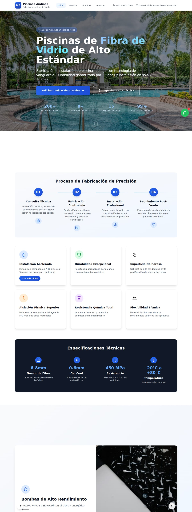
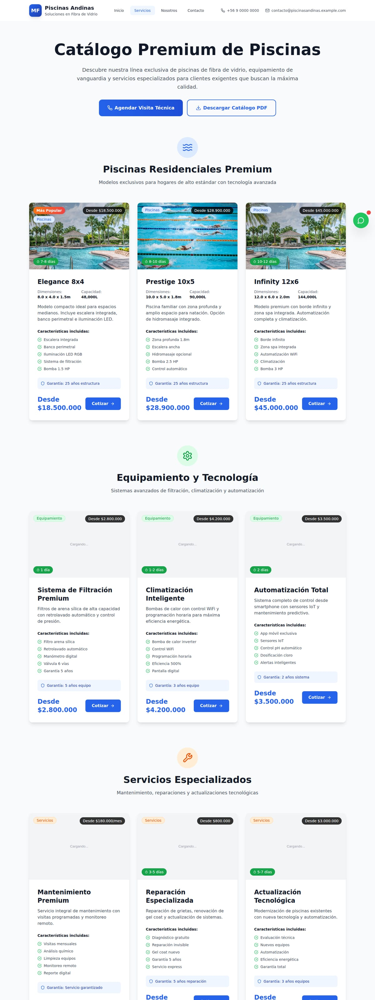
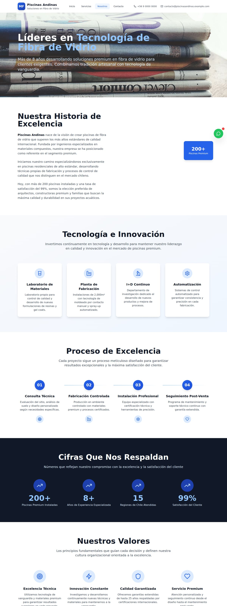
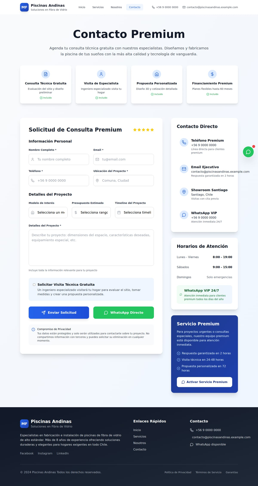
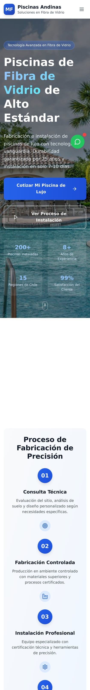
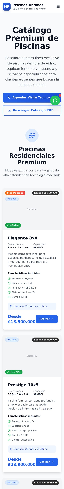
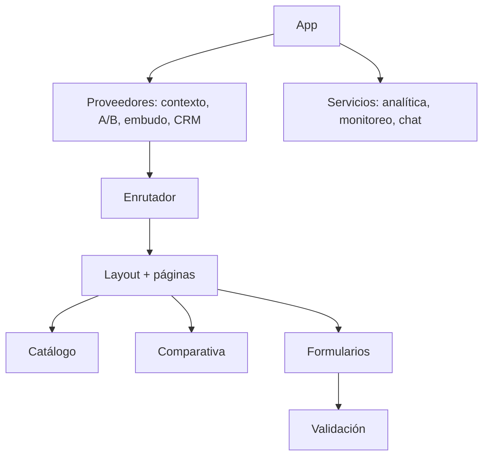

# Piscinas Andinas — plataforma web para fabricante de piscinas

> Escaparate de un sitio para una empresa de piscinas de fibra de vidrio: catálogo de modelos,
> comparativa de materiales, captación de cotizaciones, chat y automatización comercial.
> React + Vite, uso intensivo de componentes reutilizables.

| | |
|---|---|
| **Tipo** | Sitio comercial con catálogo, cotización y automatización de leads |
| **Stack** | React 18 · Vite · TypeScript · Tailwind CSS · PWA |
| **Páginas** | 4 rutas principales |
| **Estado** | Escaparate funcional: compila, renderiza y navega |
| **Alcance** | Demostración. Formularios, chat y analítica en modo simulado |

## Qué resuelve

Comprar una piscina es una decisión cara y lenta. El cliente compara materiales, no entiende
medidas ni precios, y abandona antes de escribir. El sitio ataca ese recorrido:

1. **Entiende la diferencia** → comparativa fibra de vidrio vs. hormigón vs. liner.
2. **Ve modelos concretos** → catálogo con medidas, capacidad y precio orientativo.
3. **Resuelve dudas técnicas** → especificaciones, equipamiento y garantías.
4. **Pide su cotización** → formulario guiado con datos del terreno.
5. **Recibe seguimiento** → captura de lead, puntuación automática y contacto por chat.

## Capturas

### Portada

### Servicios y materiales

### Nosotros

### Contacto

### Móvil
| Portada | Servicios | Contacto |
|---|---|---|
|  |  |  |

## Módulos

El proyecto se organiza en **18 familias de componentes**, cada una con una responsabilidad:

| Familia | Para qué existe |
|---|---|
| **Catálogo y modelos** | fichas con medidas, capacidad y precio orientativo |
| **Comparativa de materiales** | tabla que resuelve la objeción principal del cliente |
| **Formularios** | cotización y contacto con validación y estados de envío |
| **CRM / puntuación de leads** | clasifica el interés del contacto para priorizar la venta |
| **Embudo de conversión** | mide en qué paso del recorrido se pierde el visitante |
| **Pruebas A/B** | permite comparar variantes de un mensaje sin tocar el código |
| **Chat en vivo y asistente** | canal directo; el asistente responde en modo demostración |
| **Notificaciones** | avisos al usuario sin recargar |
| **SEO** | metadatos y datos estructurados por ruta |
| **Accesibilidad** | enlace de salto, foco visible, roles y etiquetas |
| **Consentimiento de cookies** | cumple el aviso previo a la analítica |
| **Rendimiento** | medición de métricas reales del navegador |
| **Monitoreo de errores** | captura y reporte de fallos en producción |
| **Retargeting** | integración de píxel publicitario, desactivada por defecto |
| **Email marketing** | integración preparada, desactivada sin claves |
| **PWA** | instalable y con soporte sin conexión |

## Cómo está construido

- **Todo proveedor que lee la ruta vive dentro del enrutador.** Si queda fuera, el hook falla y
  la aplicación cae completa: es la decisión estructural más importante del proyecto.
- **Configuración por entorno, no por código.** Si falta una clave (analítica, píxel, chat), el
  módulo no se inyecta; nunca se envía a un servicio externo «de prueba».
- **Componentes por dominio**, no por página: la misma tarjeta, tabla o formulario sirve en
  varias vistas sin duplicarse.

Detalle en [`docs/ARQUITECTURA.md`](docs/ARQUITECTURA.md),
[`docs/FUNCIONALIDADES.md`](docs/FUNCIONALIDADES.md) y
[`docs/FICHA-TECNICA.md`](docs/FICHA-TECNICA.md).

## Alcance de esta versión

Es una **vitrina**: demuestra diseño, arquitectura y flujos. No envía correos, no guarda datos y
no cobra. Los formularios confirman en pantalla y el chat responde en modo demostración.

## Créditos de imágenes

Fotografías de **Pexels**, bajo su [licencia libre](https://www.pexels.com/license/), usadas como
material de demostración y no como registro de instalaciones reales.

## Contacto

Soluciones Industriales Prime JC — [solinprimejc.com](https://solinprimejc.com)
